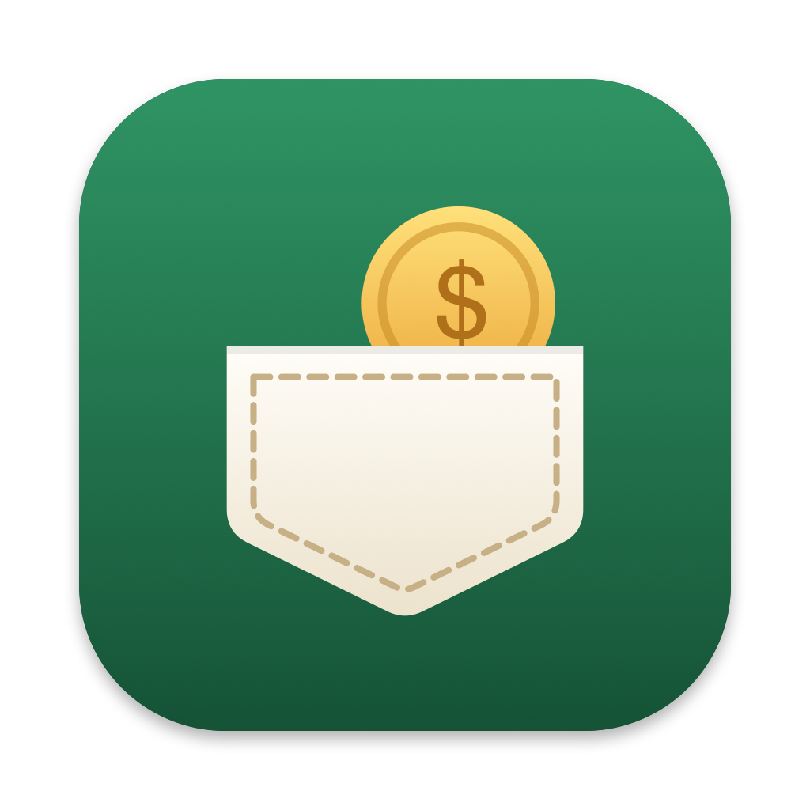

# Pocket

How much money is left, everywhere.

- `docs/`: the web app (GitHub Pages). Works on phone and any computer. Add it to your home screen.
- `menubar/`: a native macOS menubar app that shows the balance all day. Build it with `./menubar/build.sh`.
- `supabase/migrations/`: the database. Tables are locked; everything goes through key-gated `pocket_*` functions.
- `design/`: the icon source. `swift design/make-icons.swift` regenerates every icon.

What you can log:
- One-time spending or income, on any date. Future dates count when the day arrives and show up in the forecast until then.
- Repeating bills, subscriptions and income: weekly, every 2 weeks, monthly or yearly, with or without an end (for example 3 freelance payments).

The secret key is never stored in this repo. Each device asks for it once.
