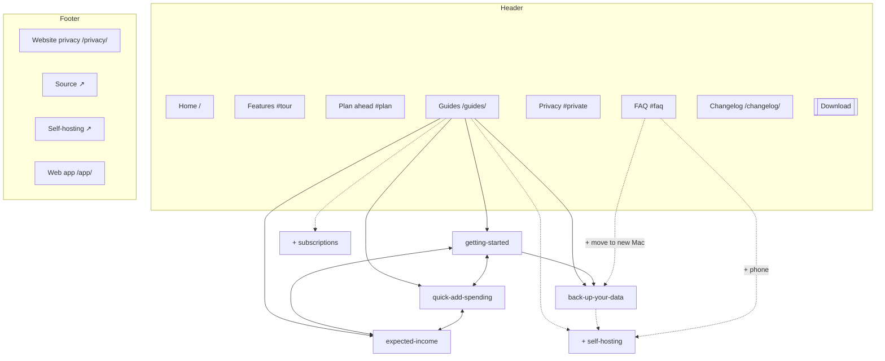

# Pocket website: site architecture

Prepared October 13, 2026, from the `web/` source (Next.js App Router, `trailingSlash: true`). Site: https://pocketleft.app. Companion to [CONTENT-STRATEGY.md](CONTENT-STRATEGY.md) and [web/SEO-SETUP.md](web/SEO-SETUP.md).

**Status, October 13:** header, shared footer, breadcrumbs, FAQ links, homepage→guide links, inline guide links, changelog start link and `/guides/self-hosting/` are implemented locally (not deployed). Still open: guide → homepage feature links (item 4 below) and release-note → guide links as releases change workflows.

Site type: small product marketing site with a help-content section. Goal order: download intent (`download_clicked`), search discovery through guides, and support for existing users. Ten public URLs today. Keep it flat: two levels, plus guide detail pages at level three.

## 1. Page hierarchy

Current pages are unmarked. `+` = recommended addition. `→` = existing redirect.

```text
Homepage (/)
├── #tour, #plan, #waiting, #quick-add, #categories, #private, #guides, #faq   (in-page sections)
├── Guides (/guides/)
│   ├── Get started with Pocket for Mac (/guides/getting-started/)
│   ├── Track everyday spending with quick-add buttons (/guides/quick-add-spending/)
│   ├── Track expected income before it arrives (/guides/expected-income/)
│   ├── Back up Pocket and move to a new Mac (/guides/back-up-your-data/)
│   ├── + Pair Pocket with your phone using your own server (/guides/self-hosting/)
│   └── + Record a month of subscriptions (/guides/subscriptions/)
├── Changelog (/changelog/)
├── Website privacy (/privacy/)
└── Web app (/app/)   noindex, outside sitemap: keep as is

/mac/ → /   (301, keep)
```

Do not nest guides by category (`/guides/start-here/...`). With 4–8 guides a category level adds clicks and longer URLs for no gain. Revisit at about 15 guides: add filter chips on `/guides/` first, and category URLs only if each category has enough guides to be a useful landing page.

## 2. Visual sitemap



## 3. URL map

| Page | URL | Parent | Nav location | Priority |
| --- | --- | --- | --- | --- |
| Homepage | `/` | — | Logo, header sections | High |
| Guides index | `/guides/` | Home | Header, footer, homepage `#guides` | High |
| Get started | `/guides/getting-started/` | Guides | Homepage cards, index | High |
| Quick-add spending | `/guides/quick-add-spending/` | Guides | Homepage cards, index | Medium |
| Expected income | `/guides/expected-income/` | Guides | Homepage cards, index | Medium |
| Back up your data | `/guides/back-up-your-data/` | Guides | Index, FAQ (+) | Medium |
| + Self-hosting | `/guides/self-hosting/` | Guides | Index, FAQ, `#private` CTA | Medium |
| + Subscriptions | `/guides/subscriptions/` | Guides | Index, `#plan` | Low (build after setup questions) |
| Changelog | `/changelog/` | Home | Header, hero announce, footer | Medium |
| Website privacy | `/privacy/` | Home | Footer | Low |
| Web app | `/app/` | — | Footer only | Not indexed |

URL rules already met: lowercase, hyphenated, short slugs, no dates or IDs, one trailing-slash policy. Keep slugs stable once guides are live; renaming one needs a 301 in `next.config.ts` `redirects()`.

## 4. Navigation spec

### Header

Seven items, `components/SiteNav.tsx`. Recommended order and labels:

1. Features (`#tour`)
2. Plan ahead (`#plan`)
3. **Data & privacy** (`#private`): renamed from "Privacy"
4. FAQ (`#faq`)
5. Guides (`/guides/`)
6. Changelog (`/changelog/`)
7. Download (CTA, rightmost)

Why:
- **"Privacy" collides with `/privacy/`.** The header link goes to the app's data-storage section, while the footer's "Website privacy" covers analytics. Someone looking for the website policy clicks the header and lands somewhere else. "Data & privacy" (or "Your data") states what the section actually covers.
- **Group same-page anchors before page links.** The first four items scroll on the homepage; the last two open other pages. Mixing them, as now, makes it harder to predict what a click will do, especially on guide pages where every anchor becomes a full navigation to `/#…`.
- Six links is the upper limit. If a link is added later, drop "Plan ahead": the Features tour and bento already reach `#plan`.

### Footer

There are four footers today: full homepage footer, `GuideFooter` (guides), a changelog footer and a privacy footer. Off the homepage, visitors lose links to the changelog, source, self-hosting and releases, and `/privacy/` has no link to guides at all.

Recommendation: one shared `SiteFooter` used on every public page, based on the homepage's columns:

| Product | Help | Project | Legal |
| --- | --- | --- | --- |
| Download for Mac | Guides | Source code ↗ | Website privacy |
| Features (`/#tour`) | Questions (`/#faq`) | Changelog | Analytics preferences |
| Plan ahead (`/#plan`) | Self-hosting (→ `/guides/self-hosting/` once built) | All releases ↗ | |
| Web app | Report a bug ↗ | Made by Orlando Ascanio ↗ | |

Pages can drop to a compact variant on narrow screens, but the link set stays the same.

### Breadcrumbs

- Guide pages: the visible trail is `Pocket / Guides / {category}`, but the BreadcrumbList schema ends in the guide **title**. Visible trail and schema should agree, and the last segment should name the current page. Change the last visible crumb to the guide title (a short title field if the full title wraps on mobile), and keep category in the eyebrow where it already appears.
- `/guides/`, `/changelog/` and `/privacy/` are one level deep; the logo is enough. No breadcrumbs needed.

## 5. Internal linking plan

### Hub and spokes

Hub: `/guides/`. Primary spoke: `/guides/getting-started/` (links to all others). Each guide's "Keep going" cards already link back to setup.

Inbound guide links today (excluding the index and the hub's own cards):

| Guide | Linked from |
| --- | --- |
| getting-started | homepage, quick-add, expected-income, back-up |
| quick-add-spending | homepage, getting-started, expected-income |
| expected-income | homepage, getting-started, quick-add, back-up |
| back-up-your-data | getting-started only |

`back-up-your-data` is the weakest page, yet it answers an existing FAQ question.

### Changes, in priority order

1. **FAQ → guides.** Add a `link` to "How do I move Pocket to a new Mac?" pointing to `/guides/back-up-your-data/` (anchor: "Read the backup and move guide"). This is the cheapest, highest-value fix.
2. **Homepage feature sections → matching guides.** Under each feature, one text link: `#quick-add` → quick-add guide, `#waiting` → expected-income guide, `#private` → back-up guide (next to the existing self-hosting CTA). These feature blocks are where intent is highest.
3. **Inline links inside guide bodies.** Guides currently link to each other only through end cards. Add contextual links where a step mentions another workflow, for example setup's "Add one upcoming bill" → expected-income, and setup's "Record one purchase" → quick-add. Needs a link-capable paragraph format in `lib/guides.ts` (e.g. a small `[text](/guides/slug/)` parser); about 1–3 links per guide.
4. **Guide pages → homepage features.** One link per guide to the relevant homepage section (`/#quick-add`, `/#plan`, `/#private`). Gives visitors who arrive from search a path to the product tour, not only to the download.
5. **Changelog → guides.** When a release changes a documented workflow, link the release note to that guide. Add a "New to Pocket? Start with the setup guide" line beside the changelog header CTAs.
6. **Move self-hosting on-site.** `#private`, the FAQ phone answer, the back-up guide and footers all send people to `SELF-HOSTING.md` on GitHub. An on-site `/guides/self-hosting/` (adapted from that file, per the content strategy) keeps those visitors on the site with a download CTA, and can be indexed under the site's domain. Keep a "Full reference on GitHub" link inside it.

### Orphan check

No orphaned public pages: all ten sitemap URLs have at least one inbound link, and `/app/` is intentionally reachable only from the footer. Re-check whenever a guide is added: it must appear in `GUIDES` (which drives the index, sitemap and static params) and in at least one other guide's `related`.

## Open questions

- Is "Plan ahead" in the header earning its click? Measuring it would need a nav event; the current analytics contract tracks only downloads and outbound links.
- Comparison pages (`/compare/...`) are a common pattern for small Mac utilities. Not recommended yet: no competitor research or search data supports it.
